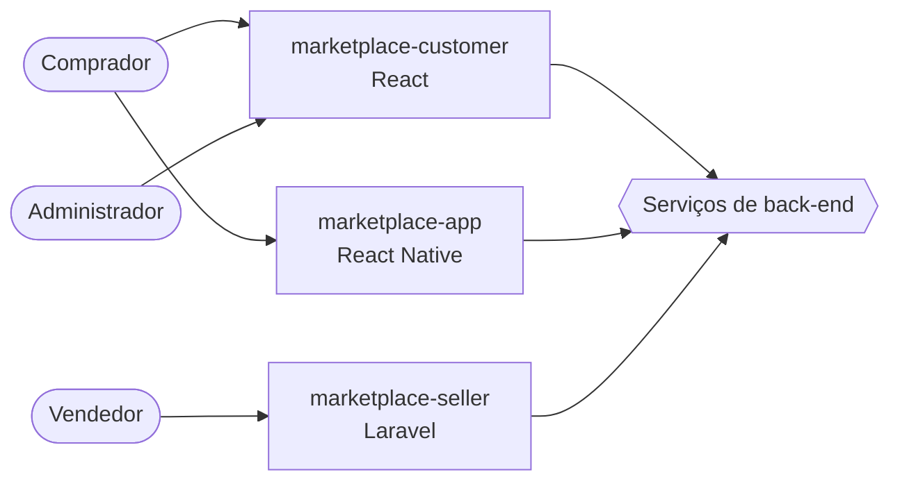
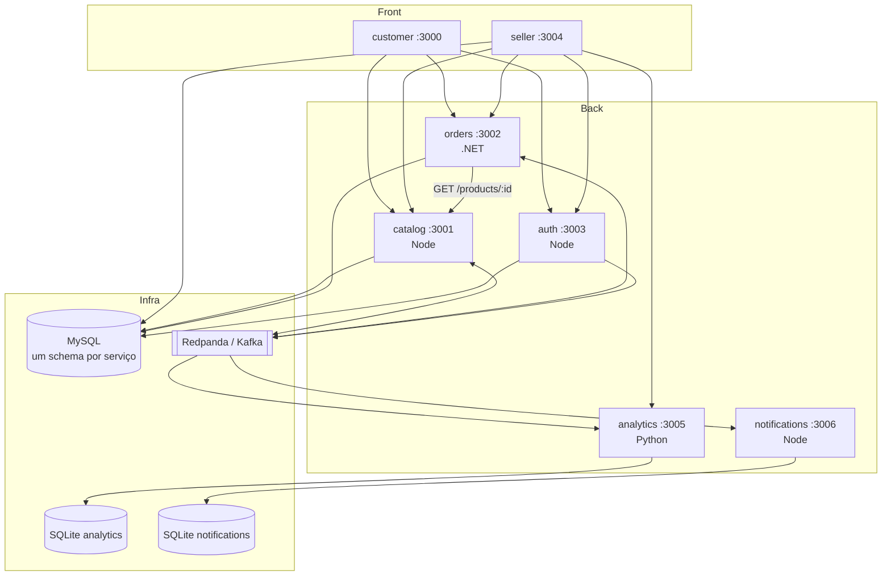

# Arquitetura

Visão geral do ecossistema. Os detalhes de cada serviço ficam no README do
próprio repositório; os contratos entre eles ficam em [CONTRATOS.md](CONTRATOS.md).

## 1. Por que microsserviços num projeto de portfólio

Um marketplace tem domínios com ritmos diferentes: catálogo muda pouco e é
lido muito; pedidos têm transação e estado; relatórios são derivados e podem
atrasar. Separar por domínio permite mostrar, em um projeto só, linguagens
diferentes resolvendo problemas diferentes, sem que a escolha pareça
arbitrária. A mensageria entra porque a saga do pedido precisa coordenar
catálogo e pedidos sem acoplar um ao banco do outro.

## 2. Contexto

## 3. Containers

## 4. Decisões

| Decisão | Alternativa descartada | Motivo |
|---|---|---|
| Um MySQL com um schema por serviço | um MySQL por serviço | mesma isolação lógica (um serviço nunca abre o schema do outro) com uma fração do custo numa VM só |
| SQLite em analytics e notifications | MySQL para tudo | são dados derivados, lidos só pelo próprio serviço e reconstruíveis a partir do tópico |
| Redpanda em vez de Kafka com ZooKeeper | Kafka "puro" | mesmo protocolo e mesmas bibliotecas cliente, um binário, 512 MB de RAM |
| Outbox no produtor | publicar direto no commit | garante que o evento existe se e só se a transação commitou |
| `processed_events` no consumidor | confiar em "exactly once" | Kafka entrega ao menos uma vez; idempotência é obrigação do consumidor |
| JWT RS256 com JWKS | HS256 com segredo compartilhado | nenhum serviço além do auth guarda segredo; chave gira sem redeploy |
| Ids ULID com prefixo | auto-incremento | id gerado antes do insert (necessário para o outbox) e legível no log |
| Pagamento simulado | integrar gateway real | o foco é a saga; a taxa de aprovação configurável permite testar os dois caminhos |

## 5. Saga do pedido

Ver [CONTRATOS.md §4.4](CONTRATOS.md#44-saga-do-pedido). Resumo: `orders` cria o
pedido como `pending` e publica `order.created`; `catalog` reserva estoque e
responde `stock.reserved` ou `stock.rejected`; `orders` confirma, simula o
pagamento e termina em `paid` ou `cancelled`. Cada passo é uma transação
local mais um evento; não há transação distribuída.

## 6. Ambientes

| Ambiente | Onde | Como sobe |
|---|---|---|
| Desenvolvimento | máquina local | `docker compose up mysql redpanda` e cada serviço com o próprio comando de dev |
| Demonstração | uma VM (Oracle Cloud ARM, plano B Hetzner) | `docker compose --profile all up -d` com as imagens de cada repositório |

## 7. Observabilidade

Cada serviço expõe `GET /health` com o estado das dependências. Logs vão para
stdout em JSON e o Docker os coleta. Redpanda Console (`--profile tools`) mostra
tópicos e mensagens durante o desenvolvimento.
