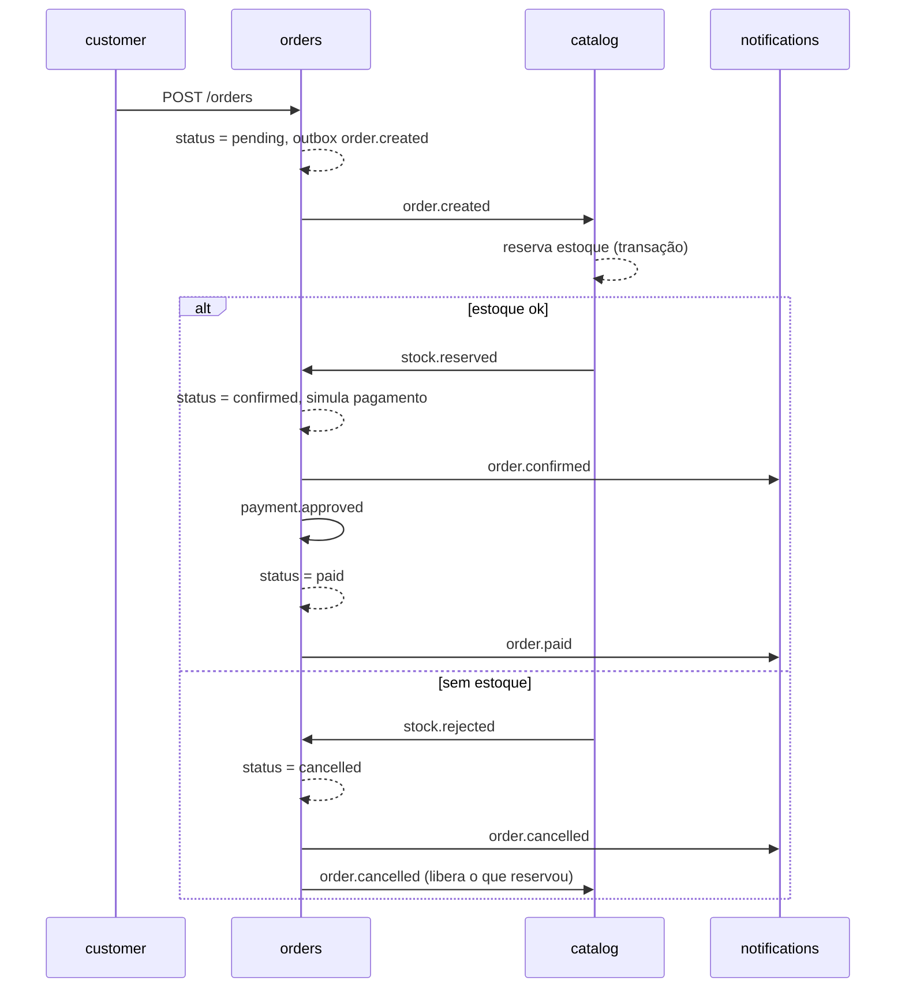

# Contratos entre serviços

Tudo que dois serviços precisam combinar está aqui: portas, bancos, eventos
Kafka, endpoints REST consumidos por outro serviço e autenticação. Um serviço
não lê o banco de outro; a comunicação é por evento ou por REST.

## 1. Mapa

| Serviço | Repositório | Porta | Banco | Expõe REST | Produz eventos | Consome eventos |
|---|---|---|---|---|---|---|
| customer | marketplace-customer | 3000 | nenhum | não (SPA) | não | não |
| catalog | marketplace-catalog | 3001 | MySQL `marketplace_catalog` | sim | `product.*`, `stock.*` | `order.created`, `order.cancelled` |
| orders | marketplace-orders | 3002 | MySQL `marketplace_orders` | sim | `order.*`, `payment.*` | `stock.reserved`, `stock.rejected` |
| auth | marketplace-auth | 3003 | MySQL `marketplace_auth` | sim | `user.registered` | não |
| seller | marketplace-seller | 3004 | MySQL `marketplace_seller` | sim (painel) | não | não |
| analytics | marketplace-analytics | 3005 | SQLite `data/analytics.db` | sim | não | `order.paid`, `product.created`, `product.viewed` |
| notifications | marketplace-notifications | 3006 | SQLite `data/notifications.db` | sim (histórico) | `notification.sent` | `user.registered`, `order.*`, `payment.*` |

Infra local (docker-compose no repositório `marketplace`):

| Recurso | Host dentro do compose | Host na máquina |
|---|---|---|
| MySQL 8 | `mysql:3306` | `localhost:3306` |
| Redpanda (Kafka) | `redpanda:9092` | `localhost:19092` |
| Redpanda Console | | `localhost:8080` |

MySQL: usuário `root`, senha `root` em desenvolvimento. Cada serviço cria o
próprio schema na primeira subida (migration `001`). Um serviço nunca abre
conexão com schema de outro.

Variáveis de ambiente que todo serviço aceita, com o mesmo nome:

```
PORT=3001
MYSQL_HOST=localhost
MYSQL_PORT=3306
MYSQL_USER=root
MYSQL_PASSWORD=root
MYSQL_DATABASE=marketplace_catalog
KAFKA_BROKERS=localhost:19092
AUTH_URL=http://localhost:3003
LOG_LEVEL=info
```

## 2. Autenticação

- `auth` emite JWT assinado com **RS256**. A chave privada fica só no `auth`.
- A chave pública é publicada em `GET {AUTH_URL}/.well-known/jwks.json`.
- Todo outro serviço valida o token buscando o JWKS (com cache de 10 min).
  Nenhum serviço compartilha segredo com o `auth`.
- Header: `Authorization: Bearer <token>`. Expiração: 1 h. Refresh token
  opaco de 30 dias, guardado com hash no banco do `auth`.

Claims:

```json
{
  "sub": "usr_01J9X...",
  "email": "ana@example.com",
  "name": "Ana",
  "role": "buyer",
  "iat": 1760000000,
  "exp": 1760003600,
  "iss": "marketplace-auth"
}
```

`role` é um de `buyer`, `seller`, `admin`. Vendedor pode ser comprador.

Regras por serviço:

| Serviço | Rota | Quem acessa |
|---|---|---|
| catalog | `GET /products`, `GET /products/:id`, `GET /categories` | público |
| catalog | `POST/PUT/DELETE /products` | `seller` (só os próprios) ou `admin` |
| catalog | `POST/PUT/DELETE /categories` | `admin` |
| orders | `POST /orders`, `GET /orders/mine` | `buyer` |
| orders | `GET /orders/:id` | dono do pedido ou `admin` |
| orders | `GET /orders` | `admin` |
| analytics | `GET /reports/*` | `seller` (só os próprios) ou `admin` |
| notifications | `GET /notifications/mine` | qualquer autenticado |

## 3. Ids

Ids públicos são strings com prefixo e ULID: `usr_`, `prd_`, `cat_`, `ord_`,
`ntf_`. O banco guarda a string como chave primária (`CHAR(30)`). Isso evita
expor sequência e permite gerar o id antes do insert (necessário para o
padrão Outbox).

## 4. Eventos

### 4.1 Envelope

Todo evento no Kafka tem este envelope. `data` varia por tipo.

```json
{
  "eventId": "evt_01J9X...",
  "type": "order.created",
  "version": 1,
  "occurredAt": "2026-10-20T13:45:00.000Z",
  "producer": "marketplace-orders",
  "data": { }
}
```

- Tópico = `type`. Partição pela chave: id da entidade raiz (`orderId`,
  `productId`, `userId`).
- Consumidor é idempotente: guarda `eventId` processados (tabela
  `processed_events`) e ignora repetição.
- Produtor usa Outbox: grava o evento na tabela `outbox` na mesma transação da
  mudança de estado, e um worker publica e marca `published_at`.
- `version` começa em 1. Mudança incompatível cria `type` novo com sufixo
  (`order.created.v2`), nunca altera o antigo.

### 4.2 Catálogo

`product.created`, `product.updated`

```json
{
  "productId": "prd_01J9X...",
  "sellerId": "usr_01J9X...",
  "categoryId": "cat_01J9X...",
  "name": "Fone Bluetooth",
  "priceCents": 19990,
  "stock": 12,
  "active": true
}
```

`product.deleted`: `{ "productId": "prd_...", "sellerId": "usr_..." }`

`product.viewed` (produzido pelo `customer` via `POST /products/:id/views` no
catalog): `{ "productId": "prd_...", "userId": "usr_..." | null }`

`stock.reserved`

```json
{
  "orderId": "ord_01J9X...",
  "items": [ { "productId": "prd_...", "quantity": 2, "priceCents": 19990 } ]
}
```

`stock.rejected`

```json
{
  "orderId": "ord_01J9X...",
  "reason": "insufficient_stock",
  "items": [ { "productId": "prd_...", "requested": 5, "available": 2 } ]
}
```

### 4.3 Pedidos

`order.created`

```json
{
  "orderId": "ord_01J9X...",
  "buyerId": "usr_01J9X...",
  "items": [ { "productId": "prd_...", "quantity": 2 } ],
  "totalCents": 39980
}
```

`order.confirmed`: `{ "orderId", "buyerId", "totalCents" }` (estoque reservado)

`order.cancelled`: `{ "orderId", "buyerId", "reason" }`
(`reason`: `insufficient_stock`, `payment_rejected`, `buyer_request`)

`payment.approved`, `payment.rejected`: `{ "orderId", "buyerId", "totalCents", "method": "pix" | "card" }`

`order.paid`

```json
{
  "orderId": "ord_01J9X...",
  "buyerId": "usr_01J9X...",
  "sellerIds": [ "usr_..." ],
  "items": [ { "productId": "prd_...", "sellerId": "usr_...", "quantity": 2, "priceCents": 19990 } ],
  "totalCents": 39980
}
```

### 4.4 Saga do pedido



Status do pedido: `pending`, `confirmed`, `paid`, `cancelled`.
Pagamento é simulado: aprova 90 % das vezes, rejeita 10 % (configurável
por `PAYMENT_APPROVAL_RATE`).

### 4.5 Usuários

`user.registered`: `{ "userId", "email", "name", "role" }`

### 4.6 Notificações

`notification.sent`: `{ "notificationId", "userId", "channel": "email" | "discord", "template", "sourceEventId" }`

## 5. REST consumido entre serviços

| Quem chama | Rota | Para quê |
|---|---|---|
| orders | `GET {CATALOG_URL}/products/:id` | preço e vendedor no momento do pedido |
| seller | `GET/POST/PUT {CATALOG_URL}/products` com o JWT do vendedor | gerir os próprios produtos |
| seller | `GET {ORDERS_URL}/orders?sellerId=` | pedidos recebidos |
| seller | `GET {ANALYTICS_URL}/reports/sales?sellerId=` | relatório |
| todos | `GET {AUTH_URL}/.well-known/jwks.json` | validar JWT |

Contrato de resposta REST em todos os serviços:

```json
{ "success": true, "message": null, "data": { } }
{ "success": false, "message": "Produto não encontrado", "errors": [ { "field": "name", "message": "obrigatório" } ] }
```

Paginação: `?page=1&perPage=20`, resposta com
`data: { items: [], page, perPage, total }`.

## 6. Health

Todo serviço responde `GET /health` com
`{ "success": true, "data": { "service": "marketplace-catalog", "version": "1.0.0", "mysql": "ok", "kafka": "ok" } }`
e status 503 se alguma dependência estiver fora.
